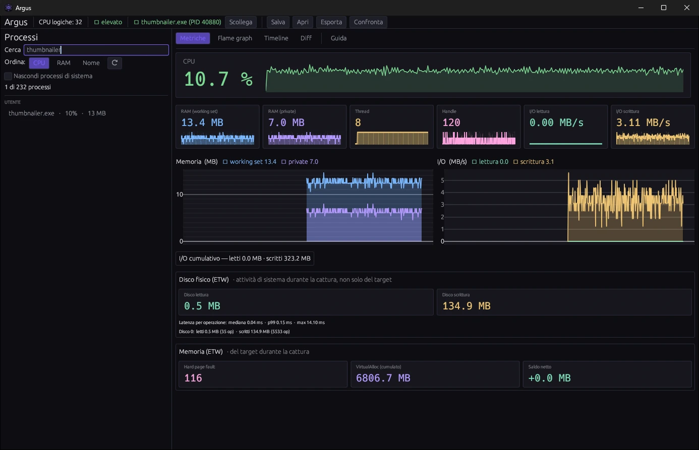
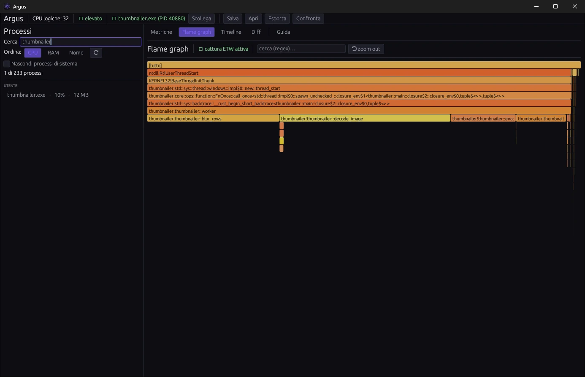
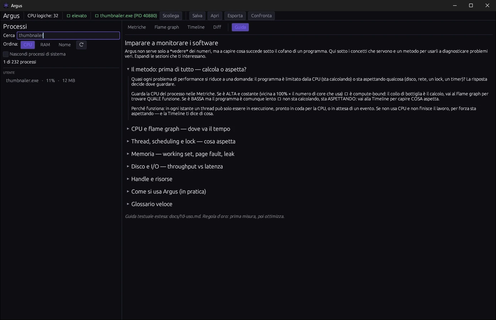

# Argus

**An educational profiler for Windows.**

[](https://github.com/caste9612/Argus/releases/latest)

[](LICENSE)

Profiling tools show plenty of numbers but don't explain what they mean, and finding out why a program was
slow took time and several tools. Argus attaches to a program that is already running, without modifying it
(no injection, no hooks), and shows its CPU, memory, I/O, threads and locks, with an explanation for every
metric and a guide to finding the bottleneck.



## Download

Download `argus-vX.Y.Z-win-x64.zip` from the [latest release](https://github.com/caste9612/Argus/releases/latest),
extract it and run `argus.exe`: it is a single portable executable. The zip also contains
`Install-Argus.ps1`, which installs Argus for the current user (`%LOCALAPPDATA%\Programs\Argus` and a Start
menu shortcut) without administrator rights.

- **Windows 10 or 11**, 64-bit.
- The flame graph, the thread timeline, disk and memory come from ETW and need Argus to **run as
  administrator**; CPU, memory, I/O, threads and handles work without it.
- The interface is in Italian.

## What it shows

- **Metrics**: CPU, working set and private memory, I/O, threads and handles, each with a graph and a tooltip
  that explains what it measures and what an unusual value means.
- **Flame graph**: where the process spends CPU time, from ETW samples, with zoom and regex search.
- **Thread timeline**: thread states over time (running, ready, waiting) and what each thread waits for:
  locks, I/O or nothing.
- **Memory and disk**: hard page faults and allocations; disk operations with median and p99 latency.
- **Sessions**: recordings saved as `.argus` files, to replay later or compare before and after a change
  (**Diff**), and export to CSV, SVG (the flame graph) or JSON.
- **Guide**: a tab that explains how to read the data and how to look for a bottleneck.



What the numbers can tell you:

- **Where the time goes**: a wide bar in the flame graph is a function that takes a lot of CPU.
- **Waiting or computing**: threads that stay *waiting* on a lock in the timeline mean the bottleneck is
  not the CPU.
- **A memory leak**: private bytes that only grow.
- **Paging**: many hard page faults, when the working set doesn't fit in RAM.
- **A handle leak**: handles that go up and never come down.
- **A disk under pressure**: a p99 latency much higher than the median.



Argus's own overhead, measured, is about 2%. The step-by-step guide is in the app and in
[docs/10-uso.md](docs/10-uso.md).

## Build from source

```powershell
cargo run --release --bin argus   # optimized build, then run
cargo test                        # unit and integration tests
cargo clippy --all-targets -- -D warnings
```

Rust 1.92 or later. The repository also builds `fixture`, a small program to profile while testing.

The design documents are in [docs/](docs/), in Italian: vision, architecture, tech stack, metrics, UI,
reliability, roadmap, development, decisions, usage and backlog. Built with Rust, windows-rs (Win32 and ETW),
wgpu and egui.

## License

[MIT](LICENSE)
